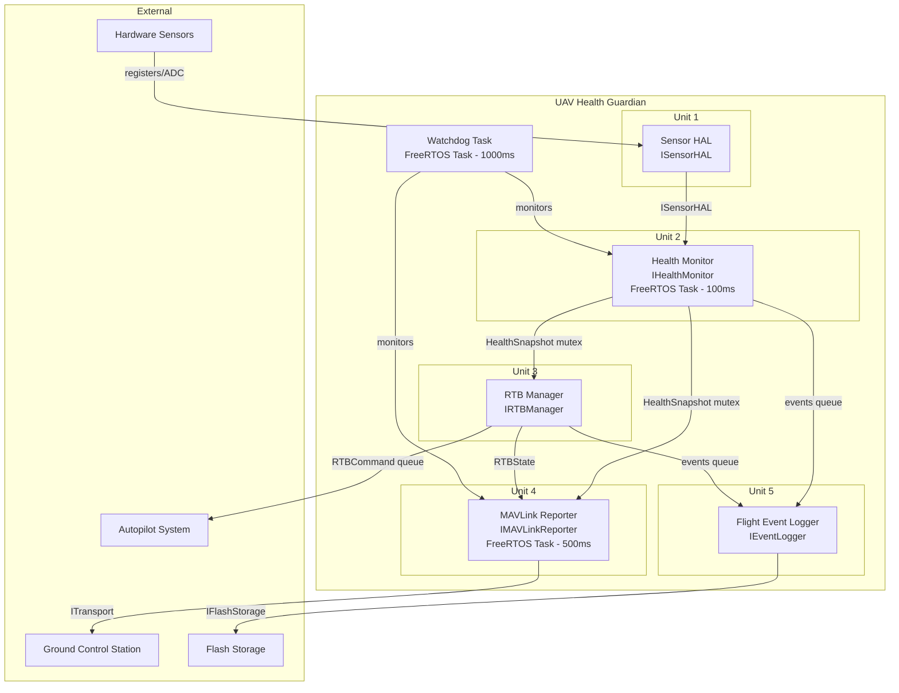

# Domain Model — UAV Flight Computer Health Guardian

---

## 1. Component Diagram



---

## 2. Data Flow

### Primary Data Path

```
┌──────────┐    SensorReading     ┌───────────────┐    HealthSnapshot     ┌──────────────┐
│  Sensor  │ ──────────────────► │    Health      │ ──────────────────► │     RTB       │
│   HAL    │   (direct call,     │   Monitor      │   (mutex-protected   │   Manager     │
│          │    within task)      │   (100ms task) │    shared memory)    │              │
└──────────┘                      └───────┬────────┘                      └──────┬───────┘
                                          │                                       │
                                          │ HealthSnapshot                        │ RTBState
                                          │ (mutex read)                          │ (atomic)
                                          ▼                                       │
                                  ┌───────────────┐                               │
                                  │   MAVLink      │◄──────────────────────────────┘
                                  │   Reporter     │
                                  │  (500ms task)  │
                                  └───────────────┘

                                  ┌───────────────┐
                                  │  Flight Event  │◄─── events from HM, RTB, WDG
                                  │    Logger      │     (FreeRTOS queue, depth 32)
                                  └───────────────┘
```

### Flow Descriptions

| Path | Mechanism | Latency Bound |
|------|-----------|---------------|
| HAL → Health Monitor | Direct virtual call within HM task context | < 1 μs (function call) |
| Health Monitor → RTB Manager | RTB reads shared `HealthSnapshot` via mutex | ≤ 100 ms (next HM cycle) |
| Health Monitor → MAVLink Reporter | Reporter reads shared `HealthSnapshot` via mutex | ≤ 500 ms (next report cycle) |
| Health Monitor → Event Logger | FreeRTOS queue push (non-blocking) | Queue depth dependent |
| RTB Manager → Event Logger | FreeRTOS queue push (non-blocking) | Queue depth dependent |
| RTB Manager → Autopilot | FreeRTOS queue (RTBCommand) | ≤ 100 ms (within HM cycle) |
| MAVLink Reporter → GCS | ITransport::send() (non-blocking) | Transport dependent |
| Event Logger → Flash | IFlashStorage::write() (batch, low priority) | Background, non-blocking to producers |

### FreeRTOS Primitives at Boundaries

| Boundary | Primitive | Purpose |
|----------|-----------|---------|
| HealthSnapshot access | `SemaphoreHandle_t` (mutex) | Protects concurrent read/write of snapshot struct |
| Event distribution | `QueueHandle_t` (depth 32) | Decouples event producers from logger task |
| RTB command delivery | `QueueHandle_t` (depth 4) | Delivers RTB commands to autopilot |
| MAVLink outbound | `QueueHandle_t` (depth 16) | Buffers formatted messages for transport |
| Threshold config update | Same mutex as HealthSnapshot | Atomic threshold reads during evaluation |
| Watchdog heartbeat | `uint32_t` atomic counters | Each task increments; watchdog checks staleness |

---

## 3. Key Data Structures

### SensorReading

```cpp
struct SensorReading {
    float temperature;      // CPU temperature in °C
    float voltage;          // Battery cell voltage in V
    float motorHealth;      // Motor controller health 0.0 (failed) to 1.0 (healthy)
    uint64_t timestamp_us;  // Microsecond timestamp from HAL
};
```

### AlertLevel

```cpp
enum class AlertLevel : uint8_t {
    NOMINAL  = 0,
    WARNING  = 1,
    CRITICAL = 2
};
```

### SubsystemType

```cpp
enum class SubsystemType : uint8_t {
    CPU_TEMP        = 0,
    BATTERY_VOLTAGE = 1,
    MOTOR_HEALTH    = 2,
    SYSTEM          = 3
};
```

### HealthSnapshot

```cpp
struct HealthSnapshot {
    SensorReading readings;

    AlertLevel temperatureAlert;
    AlertLevel batteryAlert;
    AlertLevel motorAlert;
    AlertLevel overallAlert;      // max(individual alerts) with escalation rules

    uint64_t timestamp_us;
    uint32_t sequenceNumber;      // Monotonically increasing per snapshot
};
```

### RTBState

```cpp
enum class RTBState : uint8_t {
    NOMINAL        = 0,
    DEGRADED       = 1,
    RTB_INITIATED  = 2,
    RTB_IN_PROGRESS = 3,
    LANDING        = 4,
    LANDED         = 5
};
```

### EventType

```cpp
enum class EventType : uint8_t {
    STARTUP        = 0,
    NOMINAL        = 1,
    WARNING        = 2,
    CRITICAL       = 3,
    RTB_INITIATED  = 4,
    RTB_COMPLETE   = 5,
    DEGRADED_MODE  = 6,
    WATCHDOG_RESET = 7,
    SHUTDOWN       = 8
};
```

### LogEntry

```cpp
struct LogEntry {
    EventType eventType;          // 1 byte
    SubsystemType subsystem;     // 1 byte
    uint8_t _reserved[2];        // Padding for alignment
    float sensorValue;           // 4 bytes — triggering reading
    uint64_t timestamp_us;       // 8 bytes — microsecond timestamp
    uint32_t sequenceNumber;     // 4 bytes — monotonic log sequence
    uint32_t crc32;              // 4 bytes — CRC32 over all preceding fields + message
    char message[64];            // 64 bytes — human-readable context
};                               // Total: 88 bytes (fixed size)
```

**CRC32 computation covers:** bytes 0–83 (all fields except `crc32` itself, which is at offset 20). The `crc32` field is computed last and stored in-place.

**Note:** All structs use fixed-size types, no pointers, no virtual functions — safe for direct memory copy and flash storage.

---

## 4. FreeRTOS Task Layout

### Task Table

| Task | Priority | Stack (words) | Period | Purpose |
|------|----------|---------------|--------|---------|
| Health Monitor | HIGH (3) | 2048 | 100 ms | Sample sensors, evaluate thresholds, update snapshot |
| MAVLink Reporter | MEDIUM (2) | 1024 | 500 ms (normal) / 250 ms (degraded) | Format and queue telemetry messages |
| Watchdog | HIGHEST (4) | 512 | 1000 ms | Monitor task heartbeats, restart stalled tasks |

### Priority Justification

| Priority | Rationale |
|----------|-----------|
| 4 (Watchdog) | Must preempt all application tasks to detect hangs. Minimal work — only checks counters and triggers restarts. |
| 3 (Health Monitor) | Real-time safety requirement: sensor data must be sampled at deterministic 100 ms intervals. Cannot be starved by reporting or logging. |
| 2 (MAVLink Reporter) | Telemetry is important but not safety-critical. Acceptable to defer if monitor or watchdog need CPU. |
| 1 (Event Logger)* | Lowest priority — flash writes are slow and non-blocking to producers. Events are queued; logger drains when CPU is available. |

*Event Logger runs at priority 1 but is event-driven (blocks on queue receive), not periodic.

### Shared Resource Protection

| Resource | Protection | Holder Tasks |
|----------|-----------|--------------|
| `g_healthSnapshot` | FreeRTOS Mutex (recursive) | Written by Health Monitor; read by RTB Manager, MAVLink Reporter |
| `g_eventQueue` | FreeRTOS Queue (32 entries × 88 bytes) | Written by HM, RTB, WDG; read by Event Logger |
| `g_rtbCommandQueue` | FreeRTOS Queue (4 entries) | Written by RTB Manager; read by Autopilot |
| `g_mavlinkOutQueue` | FreeRTOS Queue (16 entries) | Written by MAVLink Reporter; read by Transport task |
| `g_thresholdConfig` | Same mutex as snapshot | Written by config handler; read by Health Monitor |
| `g_taskHeartbeats[3]` | Atomic uint32_t (no mutex needed) | Incremented by each task; read by Watchdog |

### Task Timing Diagram (one cycle)

```
Time (ms)  0    100   200   300   400   500   600   700   800   900   1000
           │     │     │     │     │     │     │     │     │     │     │
HM (100ms) ├─┤   ├─┤   ├─┤   ├─┤   ├─┤   ├─┤   ├─┤   ├─┤   ├─┤   ├─┤   ├─┤
MAV(500ms) ├──┤                       ├──┤                       ├──┤
WDG(1000ms)├┤                                                          ├┤
Logger     └─triggered by queue events, runs when CPU available─────────┘
```

---

## 5. Key Design Decisions

### Decision 1: Interface-Based Dependency Injection

**Decision:** All inter-unit coupling is via pure abstract C++ interfaces (`ISensorHAL`, `IHealthMonitor`, `IRTBManager`, `ITransport`, `IFlashStorage`).

**Rationale:** Enables unit testing with mock implementations on POSIX host without requiring FreeRTOS or real hardware. Each unit can be developed, compiled, and tested independently. Also allows swapping implementations at link time for different deployment targets (POSIX sim vs. Cortex-M hardware).

**Trade-off:** Virtual dispatch adds ~2 ns per call (negligible on Cortex-M7 at 400 MHz). Accepted for testability gains.

### Decision 2: Shared Snapshot with Mutex (not Message Passing)

**Decision:** The Health Monitor writes a shared `HealthSnapshot` struct protected by a FreeRTOS mutex, rather than sending individual readings via queues to each consumer.

**Rationale:**
- Multiple consumers (RTB Manager, MAVLink Reporter) need the same data — duplicating via queues wastes RAM.
- Snapshot provides a consistent point-in-time view — consumers always see a complete, coherent state.
- Mutex hold time is bounded (single struct copy, ~88 bytes, < 1 μs on Cortex-M7).

**Trade-off:** Mutex introduces potential priority inversion. Mitigated by FreeRTOS priority inheritance protocol (enabled by using `xSemaphoreCreateMutex()`).

### Decision 3: Event Queue for Logging (Fire-and-Forget)

**Decision:** Event producers (Health Monitor, RTB Manager, Watchdog) push `LogEntry` structs onto a shared FreeRTOS queue. The Logger drains the queue at lowest priority.

**Rationale:**
- Decouples real-time monitoring from slow flash writes.
- Producers never block on I/O — if the queue is full, the event is dropped (counted as a metric, not a failure).
- Batch flash writes (when queue depth > high-water mark) amortize flash write overhead.

**Trade-off:** Queue depth (32 entries × 88 bytes = 2.75 KB RAM) must be sized to handle burst events without overflow. Validated against worst case: 3 subsystems transitioning simultaneously = 3 entries + 1 RTB entry = 4 entries per burst.

### Decision 4: No Dynamic Memory After Initialization

**Decision:** All memory is statically allocated or allocated from FreeRTOS static pools during `init()`. No `new`, `malloc`, or container growth after task creation.

**Rationale:**
- Heap fragmentation is the #1 cause of field failures in long-running embedded systems.
- Static allocation makes memory usage deterministic and auditable at link time.
- Required for safety-critical certification (DO-178C considerations).

**Trade-off:** Fixed-size buffers (256-entry log, 16-message MAVLink queue) mean capacity is bounded. Sized via worst-case analysis; overflow is handled gracefully (drop policy, not crash).

### Decision 5: RTB Logic in Polling Consumer (not Interrupt-Driven)

**Decision:** The RTB Manager evaluates the health snapshot within the Health Monitor's task cycle (called synchronously after threshold evaluation), rather than running as a separate interrupt-triggered task.

**Rationale:**
- RTB decisions are derived from the same data the Health Monitor just produced — evaluating immediately eliminates one task switch and one mutex acquisition.
- Worst-case latency from sensor breach to RTB command: 100 ms (one HM period) — well within the 100 ms requirement from SC-4.
- Fewer tasks = less context-switch overhead and simpler timing analysis.

**Trade-off:** RTB Manager shares the Health Monitor's stack and priority. If RTB evaluation becomes complex (currently ~50 μs worst case), it could be promoted to its own task later without interface changes.
